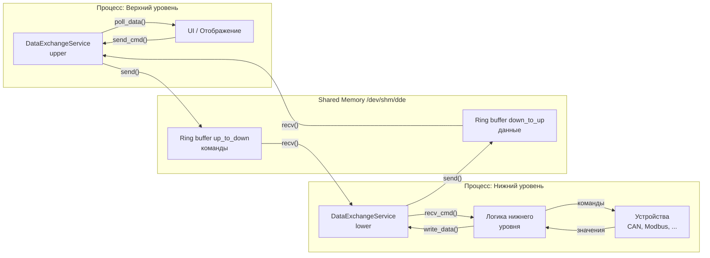
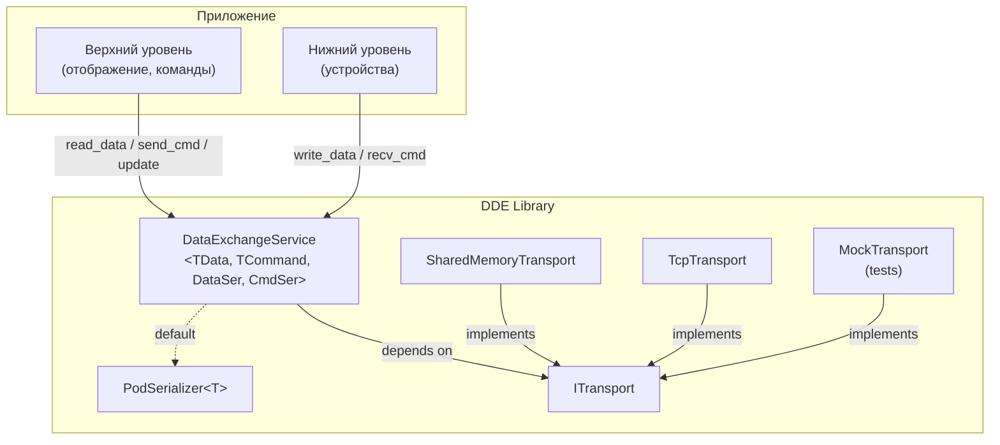

# Проектная работа DDE Service (Device Data Exchange Service) 
## Курс Otus C++ Developer. Professional 

## 1. Цель

Разработать библиотеку-сервис для **двунаправленного** обмена данными между процессами и потоками. Единый API, независимый от транспорта: POSIX shared memory и TCP.

Это разновидность двунаправленного Consumer-Producer сервиса для телеметрии **данных** и отправки команд. Потребителем сервиса выступают модули «верхнего» уровня и модули «нижнего» уровня.
Назначение верхнего и нижнего уровня может быть разным, но в нашем примере верхний уровень предназначен для обработки и отображения данных, а нижний — для получения данных из устройств.

Данные - параметры или осциллогаммы
Команды - команды на запись или чтение данных из/в устройств

Сервис **обобщённый** и не привязан к конкретной предметной области: он работает с двумя произвольными типами — `TData` (поток данных) и `TCommand` (поток команд).

---
## 2. Функциональные требования к сервису

**Сервис обеспечивает два независимых однонаправленных потока:**

- **Поток данных:** Push-модель. Нижний уровень пишет данные по мере их поступления от устройств; Верхний уровень считывает их в своём цикле.
- **Поток команд:** Верхний уровень отправляет команды чтения/записи; Нижний уровень принимает и выполняет их.
- Потоки **независимы** и не блокируют друг друга: у каждого свой буфер и своя синхронизация. Подтверждение на получение команды или данных — не требуется.
- При переполнении буфера данных новые значения не пишутся, `send` возвращает `Busy`. Потеря значений допустима (данные используются для отображения).
- При переполнении буфера команд новые значения не пишутся, `send` возвращает `Busy`, но команды не теряются, остаются до следующей отправки.
- Потокобезопасность: публичные методы сервиса можно вызывать из нескольких потоков.
- Два транспорта: `SharedMemoryTransport` и `TcpTransport` (TCP — в потенциале, без реализации в v1.0).
- Транспорт обеспечивает два независимых направления: `Up→Down` (команды) и `Down→Up` (данные), каждое со своим буфером.
- Пакетная отправка (батчинг) обязательна как для данных, так и для команд. Данные группируются в пакеты по источнику (устройству или группе) и отправляются одним сообщением.
- Два режима отправки команд : цикловой (сразу возвращаем управление) и синхронный(проверяем на переполнение или таймаут, повторная отправка с паузами)
- **Обобщённость:** сервис работает с любыми сериализуемыми структурами `TData` и `TCommand`. По умолчанию — POD-типы через `memcpy`. Пользователь может подставить свой сериализатор через template-параметр.
- Демо: верхний и нижний уровни, работа через `SharedMemoryTransport`.
- Тесты: unit + интеграционные (с транспортом).

---

## 3. Нефункциональные требования

- Номинальная нагрузка (параметры)	25 600 значений/сек
- Пиковая нагрузка (запас ×3): 76 800 значений/сек
- Пропускная способность транспорта	≥ 250 000 сообщений/сек
- Транспорт (shm и TCP) должен обеспечивать ≥ 80 000 сообщений/сек.
- Задержка «запрос-ответ» через разделяемую память: не более 10 мкс.
- Задержка «запрос-ответ» через TCP(localhost): не более 500 мкс.
- Смерть любого процесса не блокирует других
- Потоки параметров и команд не блокируют друг друга (разные ring buffer'ы)
- Верхний уровень должен иметь возможность читать параметры без блокировки (`timeout = 0`)
- Для синхронной отправки команд, повторная попытка с увеличивающейся паузой при состояниях «занято» или «таймаут» во время отправки.
- C++17, Linux x86-64, CMake ≥ 3.16.

---

## 4. Архитектура

Диаграмма потоков данных


Диаграмма классов обобщенная


---

## 5. API 

### 5.1. Сервис обмена данными

```cpp
enum class Status { Ok, Busy, Timeout, Disconnected, Error };

// Сериализатор по умолчанию: работает для любых trivially copyable типов.
template<typename T>
struct PodSerializer {
    static_assert(std::is_trivially_copyable_v<T>,
                  "PodSerializer requires a trivially copyable type");

    static std::vector<std::byte> pack(const T* arr, size_t n);
    static bool unpack(const void* buf, size_t len, T* out, size_t cap, size_t& n);
};

// Обобщённый сервис обмена данными.
// TData    — тип элемента потока данных 
// TCommand — тип элемента потока команд 
// DataSer  — сериализатор для TData   (по умолчанию PodSerializer<TData>)
// CmdSer   — сериализатор для TCommand (по умолчанию PodSerializer<TCommand>)
template<typename TData, typename TCommand,
         typename DataSer = PodSerializer<TData>,
         typename CmdSer  = PodSerializer<TCommand>>
class DataExchangeService {
public:
    explicit DataExchangeService(std::unique_ptr<ITransport> t,
                                 uint16_t data_kind, uint16_t cmd_kind);

    Status init(const std::string& endpoint);
    void   stop();

    // Поток данных: Нижний → Верхний
    Status write_data(const TData&);                    // нижний: положить значение
    Status poll_data(TData&);                           // верхний: забрать без ожидания
    Status read_data(TData&, std::chrono::milliseconds);// верхний: забрать с ожиданием

    // Поток команд: Верхний → Нижний
    Status send_cmd(const TCommand&);                   // верхний: положить команду
    Status recv_cmd(TCommand&, std::chrono::milliseconds); // нижний: принять команду

    Status flush(std::chrono::milliseconds timeout);    // отправить синхронно очередь команд с ожиданием
    void   update();  // отправить накопленные команды в транспорт (периодически)
};
```

### 5.1. Интерфейс транспорта

```cpp
enum class Status {
    Ok,             // операция выполнена
    Busy,           // буфер заполнен
    Timeout,        // операция не завершилась за отведённое время
    Disconnected,   // соединение разорвано
    Error           // внутренняя ошибка системы
};

enum class MsgKind : uint16_t {
    DataPush = 1,
    CommandBatch
};

// Заголовок сообщения. Передаётся перед payload'ом.
struct MsgHeader {
    MsgKind kind;          // тип сообщения 
    uint16_t count;         // число элементов в payload
    uint32_t payload_len;   // длина payload в байтах
};

class ITransport {
public:
    virtual ~ITransport() = default;

    // Открыть транспорт. endpoint — имя shm-сегмента или "host:port".
    virtual Status open(const std::string& endpoint) = 0;

    // Закрыть транспорт и освободить ресурсы.
    virtual void   close() = 0;

    // Отправить один фрейм: [MsgHeader][payload].
    // Возвращает Busy, если буфер полон; Timeout — если не удалось за отведённое время.
    virtual Status send(const MsgHeader& hdr,
                        const void* payload, size_t payload_len) = 0;

    // Принять один фрейм. payload пишется в buf (не больше cap).
    // Блокирует до timeout. Timeout — если данных нет.
    virtual Status recv(MsgHeader& hdr,
                        void* buf, size_t cap, size_t& out_len,
                        std::chrono::milliseconds timeout) = 0;

    virtual bool is_connected() const = 0;
};
```

### 5.2. Пример применения — частный случай «телеметрия параметров устройства»

```cpp
struct Parameter {                       // = TData
    uint16_t device_id, module_id, param_id;
    uint32_t value;
    int64_t  timestamp_ns;
};

struct Command {                         // = TCommand
    uint16_t device_id, module_id, param_id;
    uint32_t value;
    uint8_t  nRW;                        // read/write flag
};

using ParamExchangeService = DataExchangeService<Parameter, Command>;
```

---
## 5. План реализации
- CMake-скелет, типы, интерфейсы, АПИ, сериализация
- `ITransport` + `MockTransport` + unit-тесты
- `SharedMemoryTransport`: два ring buffer'а (`up_to_down`, `down_to_up`), robust mutex   |
- `DataExchangeService`: `write_data`, `poll_param` без блокировки, `read_param` с таймаутом  |
- `DataExchangeService`: `send_cmd`, `recv_cmd` отдельная очередь  |
- Демо верхнего/нижнего уровней, интеграционные тесты 

Дополнительно:
- `TcpTransport` с сериализацией
- `TcpTransport` сериализация через protobuf
---

## 6.  Критерии приёмки
- Сборка одной командой: cmake -B build && cmake --build build.
- Все unit- и интеграционные тесты проходят: ctest — 100% зелёный.
- Демо на примере «телеметрия параметров устройства», всё работает через SharedMemoryTransport на одном компьютере. 
- Демо: пишем данные для нескольких устройств, считываем со скоростью 8 знач/в сек для всех параметров всех устройств, никаких тормозов и растущих очередей
- Поток данных и поток команд работают одновременно и не блокируют друг друга.
- При переполнении буфера данных write_data возвращает Busy, значения теряется (без падения и без остановки).
- При переполнении буфера команд (Busy) команды не теряются, остаются до следующей отправки, и в итоге будут доставлены все команды
